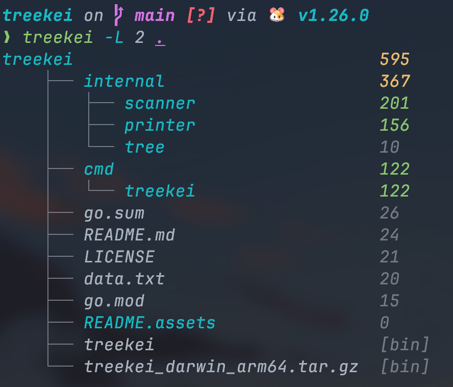

# Treekei - File Tree with Line Counts

English | [简体中文](./README-CN.md)


[](https://opensource.org/licenses/MIT)

---

## Usage



---

## Motivation

Existing command-line tools like `tree` can display the directory structure, and `tokei` can count lines of code by language. However, there isn’t a simple way to quickly understand how code is distributed across a project.

`treekei` combines a file tree with line counts, allowing you to quickly grasp the code distribution of a project when you first explore it.

| Tool    | Tree | Line Count | Combined View |
| ------- | ---- | ---------- | ------------- |
| tree    | ✅    | ❌          | ❌             |
| tokei   | ❌    | ✅          | ❌             |
| treekei | ✅    | ✅          | ✅             |

---

## Installation

### macOS

```shell
brew update
brew tap zihao-liu-qs/treekei
brew trust --formula zihao-liu-qs/treekei/treekei   # Homebrew 7+ requires trusting third-party taps
brew install treekei
```

### Linux

You can download the prebuilt binary from the GitHub Releases page and place it in a directory that is included in your `PATH`

## Options

- `--all`
  Include hidden files.
- `--dir-only`
  Display directories only.
- `--lang string`
  Only count code for the specified programming language.
- `--level int`
  Set the maximum depth of the output tree.
- `--sort string`
  Sorting method of the tree structure.
  Defaults to sorting by lines of code. Can be set to alphabetical order.

You can view all available options with:

```shell
treekei --help
```

To list the language names accepted by `--lang`:

```shell
treekei list-langs
```

------

## Supported Platforms

### Operating Systems

Currently tested on macOS (Apple Silicon).
In theory, it should work on any Unix-like system.
Windows is not officially supported yet, sorry.

### Installation Methods

Homebrew installation is currently provided for macOS only.
Users on other platforms can build from source:

```shell
go build -o treekei ./cmd/treekei/main.go
```

### Color Support

If your terminal supports colors, `treekei` will display colored output.

------

## Releasing (maintainers)

Releases are automated with [GoReleaser](https://goreleaser.com) through GitHub Actions. To cut a new release, just push a tag:

```shell
git tag v0.2.5
git push origin v0.2.5
```

The workflow then builds binaries for all supported platforms, publishes the GitHub Release, and updates the Homebrew tap (`Formula/treekei.rb`) automatically. It requires a `HOMEBREW_TAP_GITHUB_TOKEN` Actions secret with write access to the `homebrew-treekei` repository.

------

## Contributors

<a href="https://github.com/zihao-liu-qs/treekei/graphs/contributors">
  
</a>

------

## License

MIT

------

If you find this tool useful, feel free to give it a ⭐ — it helps more people discover it!